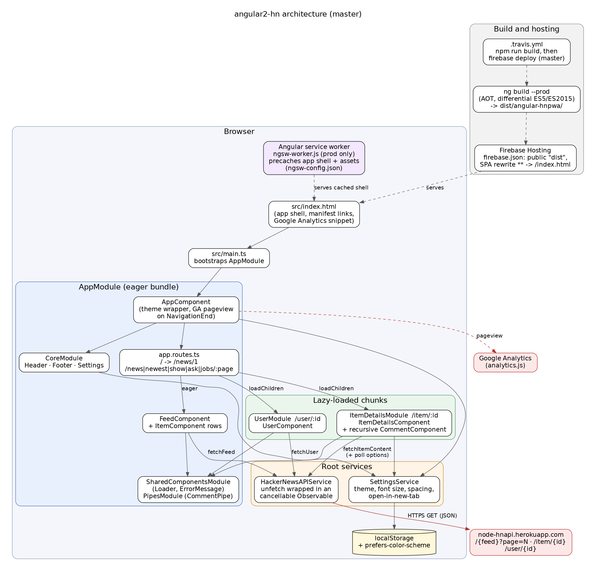

# Architecture

How the code on `master` is put together. The diagram source is [`diagrams/architecture.dot`](diagrams/architecture.dot) (Graphviz); re-render the PNG and SVG with [`diagrams/render.sh`](diagrams/render.sh) after editing it.

## Overview

Angular 2 HN is a client-only Progressive Web App built with the Angular CLI (Angular 9, RxJS 6, TypeScript 3.7). There is no backend in this repository: the browser reads Hacker News data as JSON from the public [node-hnapi](https://github.com/cheeaun/node-hnapi) service and keeps user preferences in `localStorage`.

## Runtime

| Part | Where | What it does |
| --- | --- | --- |
| App shell | `src/index.html`, `src/main.ts` | Loads the Google Analytics snippet and the web app manifest, then bootstraps `AppModule`. |
| Root module | `src/app/app.module.ts` | Declares `AppComponent`, `FeedComponent` and `ItemComponent`; imports `CoreModule`, `SharedComponentsModule`, `PipesModule` and registers the service worker. |
| Routing | `src/app/app.routes.ts` | `/` redirects to `/news/1`. `/news`, `/newest`, `/show`, `/ask` and `/jobs` each take a `:page` child that renders `FeedComponent`, with the feed name passed as route `data.feedType`. `/item/:id` and `/user/:id` are lazy-loaded with `loadChildren`. |
| Feeds | `src/app/feeds/` | `FeedComponent` fetches one page of a feed (30 stories) and renders an `ItemComponent` per story. |
| Item details (lazy) | `src/app/item-details/` | `ItemDetailsComponent` shows a story with its comment tree; `CommentComponent` renders itself recursively for replies. Poll stories also fetch each poll option. |
| User profile (lazy) | `src/app/user/` | `UserComponent` shows a Hacker News user. |
| Core chrome | `src/app/core/` | `HeaderComponent` (feed navigation), `FooterComponent` and the `SettingsComponent` panel. |
| Shared UI | `src/app/shared/components`, `src/app/shared/pipes` | `LoaderComponent`, `ErrorMessageComponent` and `CommentPipe` (comment count text). |
| Models and styles | `src/app/shared/models`, `src/app/shared/scss` | TypeScript interfaces for stories, comments, users, polls and settings; the theme and media-query Sass partials. |

### Data access

`HackerNewsAPIService` (`src/app/shared/services/hackernews-api.service.ts`) calls `https://node-hnapi.herokuapp.com` with [`unfetch`](https://github.com/developit/unfetch), wrapped in an RxJS `Observable` that ignores the response if the subscriber unsubscribes first:

| Method | Request |
| --- | --- |
| `fetchFeed(feedType, page)` | `GET /{feedType}?page={page}` |
| `fetchItemContent(id)` | `GET /item/{id}`, plus `GET /item/{id + n}` per option for polls |
| `fetchUser(id)` | `GET /user/{id}` |

### Settings and themes

`SettingsService` (`src/app/shared/services/settings.service.ts`) holds the theme (`default`, `night`, `amoledblack`), title font size, list spacing and the open-links-in-new-tab flag, and saves each to `localStorage`. With no saved theme it follows the system `prefers-color-scheme` (dark selects `night`). `AppComponent` applies the theme as a CSS class around the whole app.

### Analytics

`AppComponent` sends a Google Analytics `pageview` on every router `NavigationEnd`; the tracker is created by the inline snippet in `src/index.html`.

## Offline support

Production builds register the Angular service worker (`@angular/service-worker`, `ngsw-worker.js`); it is disabled in development (`environment.production` is false). `ngsw-config.json` prefetches the app shell (`index.html`, JS, CSS, favicon) and lazily caches `assets/`. It has no `dataGroups`, so API responses are not cached by the service worker.

## Build, test and deploy

| Step | Command / file | Notes |
| --- | --- | --- |
| Dev server | `npm start` (`ng serve`) | http://localhost:4200, no service worker. |
| Production build | `npm run build -- --prod` | AOT, differential ES2015/ES5 bundles, `ngsw.json` and `ngsw-worker.js`, output in `dist/angular-hnpwa/`. |
| Unit tests | `npm test` (Karma + Jasmine) | `master` has no `*.spec.ts` files, so Karma reports `Executed 0 of 0 ERROR`. |
| Lint | `npm run lint` (TSLint) | Reports existing style errors on `master`. |
| e2e | `npm run e2e` (Protractor) | Still the CLI scaffold spec that expects `Welcome to angular-hnpwa!`, which the app does not render. |
| CI / deploy | `.travis.yml` | On `master`: `npm run build`, then `firebase deploy` with `$FIREBASE_TOKEN`. |
| Hosting | `firebase.json`, `.firebaserc` | Firebase Hosting with a `** -> /index.html` SPA rewrite; projects `angular2-hn` (default) and `angular2-hn-experiment`. `database.rules.json` restricts the Realtime Database to authenticated users; the app does not use it. |

Use Node 10 or 12 (verified with Node 12.22). On Node 17 and later, `ng build --prod` fails while generating the ES5 bundles (`You must provide the URL of lib/mappings.wasm`).

### Known drift in committed config

These are left as they are; the docs describe them so they are not a surprise:

- `firebase.json` publishes `dist`, but the CLI writes the app to `dist/angular-hnpwa/`, so a deploy as configured has no `index.html` at the site root.
- `.travis.yml` pins Node 6.9 and runs `npm run build` without `--prod`; Angular 9 needs Node 10.13 or later, and a non-production build has no service worker.
- `src/index.html` links both `/manifest.json` (present) and `manifest.webmanifest`, which does not exist in `src/`, so the second link returns 404. `ngsw-config.json` lists `/manifest.webmanifest` too.

## Who wrote it

From `git blame` on `master`:

- **Houssein Djirdeh** created the app and wrote most of the components, styles and app shell.
- **Stephen Fluin** moved it from the ejected Webpack / Workbox setup to the Angular CLI 9 workspace (`angular.json`, `ngsw-config.json`, lazy `loadChildren` imports) in #80.
- **Ashwin Sureshkumar** split the code into core, shared components, services and pipes (#43); **Zach Berger** wrote much of the current `HackerNewsAPIService`; **Jeff Cross** wrote the current route table.
- **Zack Wilson (PortEXE)** built the settings panel markup, **Antogin** added font size and list spacing (#58), and **Miroslav Foltýn** added system colour-scheme detection (#83).
